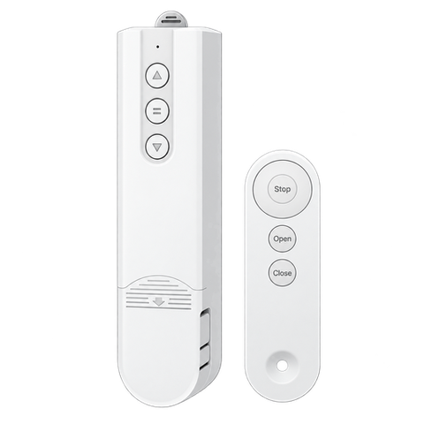
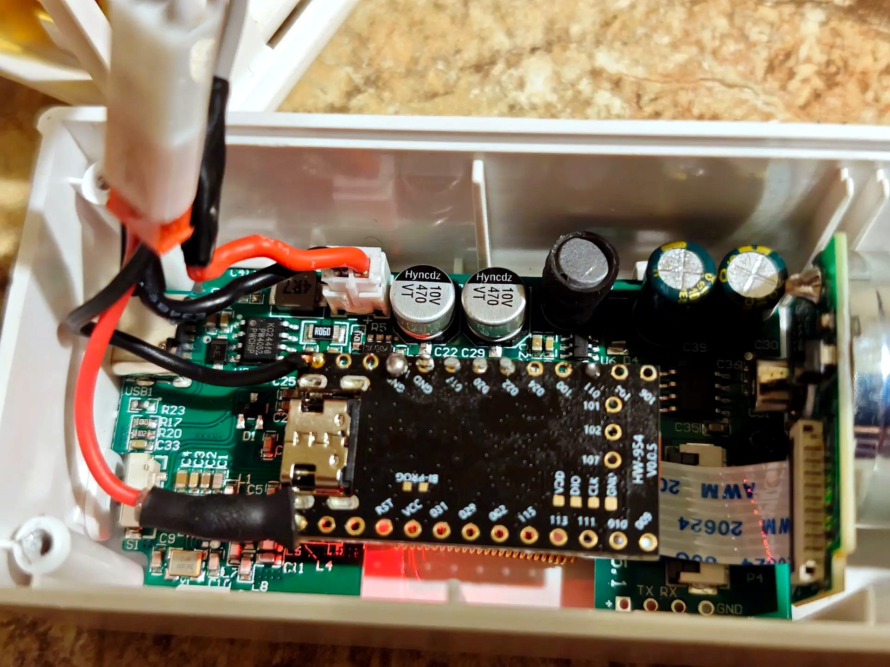
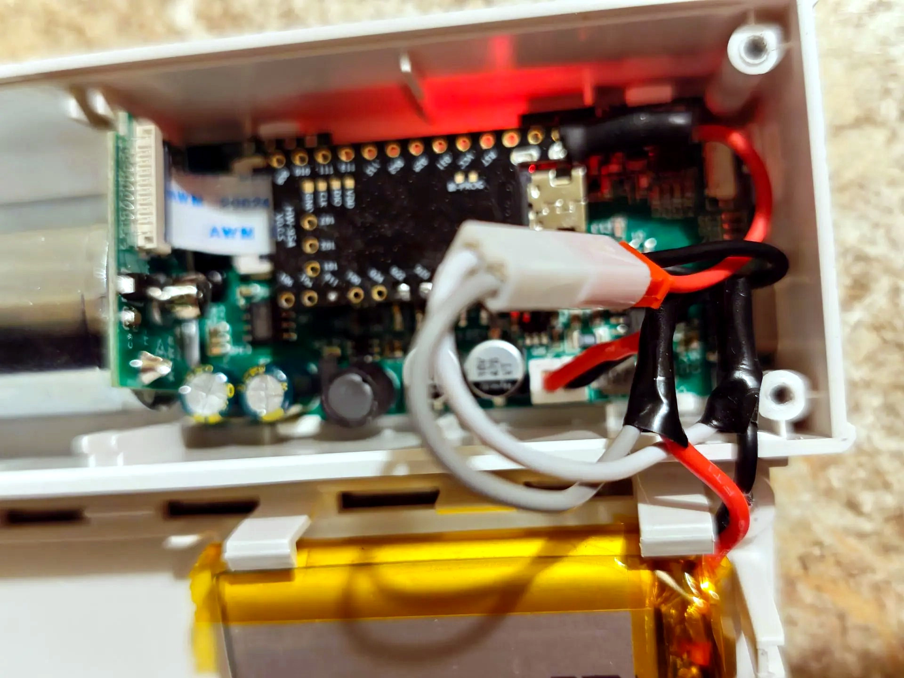
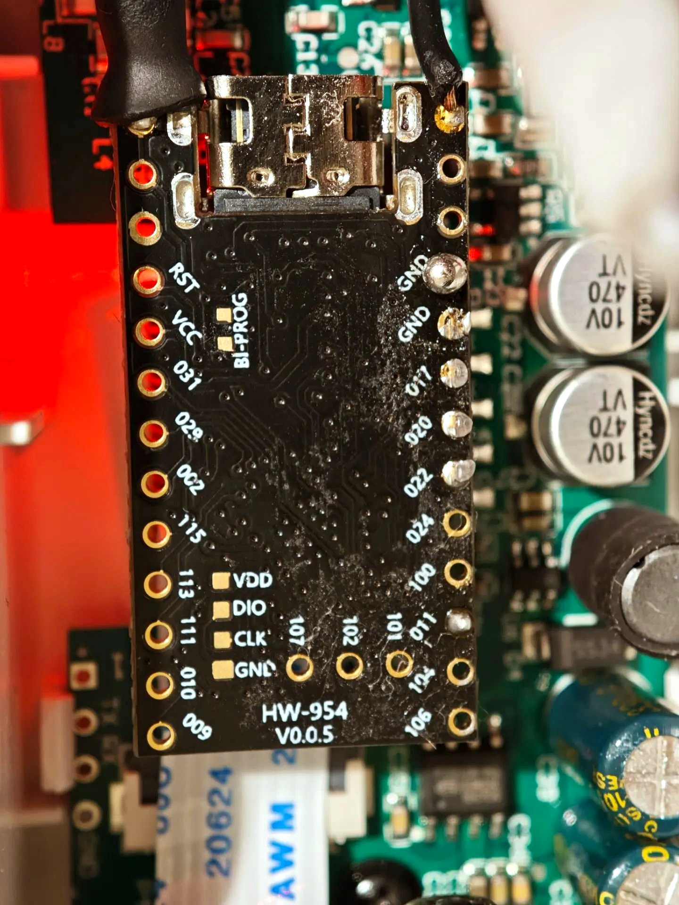
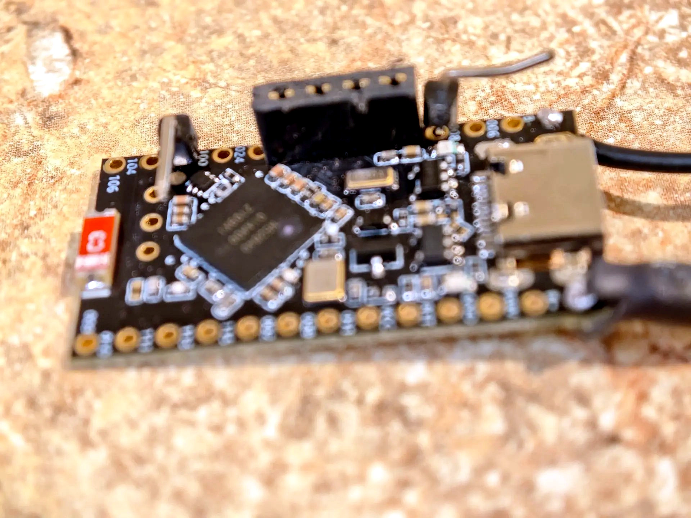
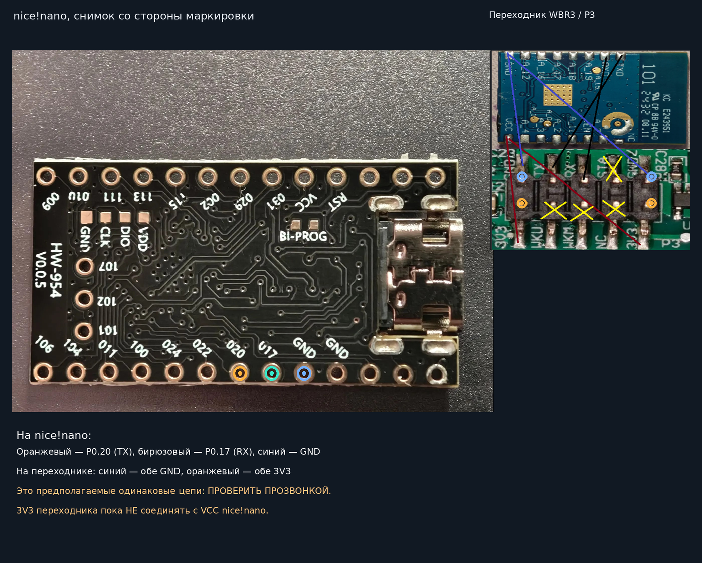
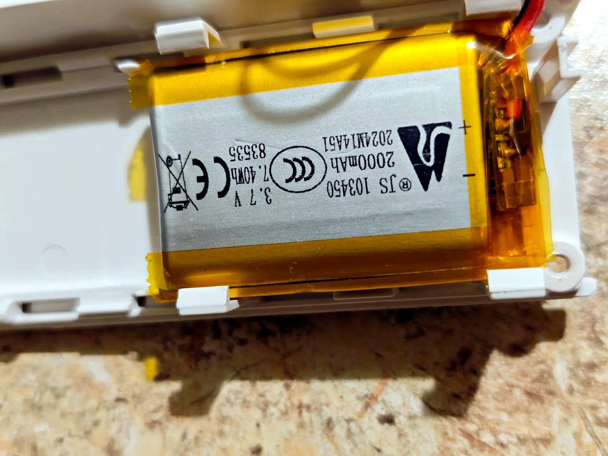

# P3-NRF52840 — Zigbee roller blind (HW-954)

<p align="center">
  
</p>

Проект управления мотором шторы Tuya P3 на nRF52840 (плата HW-954 / nice!nano-совместимая), Zigbee End Device, endpoint 10. Проверенная пользователем функциональность: OPEN / CLOSE / STOP, положение 0–100%, локальная кнопка и аппаратное обучение конечных положений, сохранение настроек после отключения питания, работа через Zigbee2MQTT.

## Фотографии готовой сборки



*Реальный монтаж HW-954 на основной плате привода P3. Это фотография конкретной сборки, а не универсальная схема подключения.*



*Укладка проводов в корпусе. Перед окончательной сборкой исключите натяжение, пережатие и контакт проводников с движущимися частями.*

## Плата и подключение



*Подписи на обратной стороне HW-954 помогают сверить номера выводов, но не заменяют проверку распиновки конкретной ревизии.*



*Лицевая сторона HW-954 с nRF52840, USB-C и компонентами платы.*

### UART между основной платой P3 и HW-954

```text
Основная плата мотора P3       nRF52840 HW-954
GND ------------------------- GND
TX  ------------------------- RX (P0.22)
RX  ------------------------- TX (P0.20)
```

*Здесь «мотор» — основная плата управления P3, к которой подключается переходник. TX/RX перекрещиваются; земля общая. До подключения подтвердите уровень UART 3,3 В и соответствие обозначений P0.20/P0.22 текущей конфигурации прошивки.*




*Иллюстрация с обозначенными контактами платы. Перед подключением проверяйте назначение выводов по своей ревизии HW-954 и мультиметром; изображение не заменяет электрическую проверку.*

## Питание nRF52840 от аккумулятора (АКБ)



*Аккумулятор на фотографии: JTS 103450, Li-ion/LiPo 1S, номинально 3,7 В, 2000 мА·ч (7,40 Вт·ч). Это характеристики по маркировке, а не измеренная полезная ёмкость. Второй мотор проходит испытание автономности с таким же аккумулятором; время работы пока не установлено.*


**Для HW-954 сначала установите маркировку именно вашей ревизии платы.** Прошивка не определяет распиновку цепи питания и не подтверждает наличие на конкретном экземпляре зарядного контроллера или защиты аккумулятора.

Для используемой схемы с **диодом Шоттки SS24** аккумулятор 1S подключается через диод **в разрыв плюсового провода** к подтверждённому аккумуляторному входу платы:

```text
АКБ 1S (+) ─── анод A [ SS24 ] катод K ─── BAT+ / B+ платы
                                    ↑
                       полоска на корпусе SS24
АКБ 1S (−) ──────────────────────────── BAT− / GND платы
```

**Полоска (катод K) SS24 — в сторону платы HW-954; анод A — в сторону плюса АКБ.** Минус аккумулятора соединяется с GND напрямую. Диод уменьшает напряжение питания платы на своё прямое падение и блокирует обратный ток в сторону АКБ по этой ветви; он **не заменяет** защиту Li-ion, контроллер заряда и проверку совместимости одновременного питания USB/АКБ. Ставить SS24 можно только после подтверждения, что эти площадки действительно предназначены для 1S АКБ.

- **Не подключайте аккумулятор к `3V3`, `VCC`, `5V`, `VBUS` или GPIO**, пока не установлена электрическая схема платы. Напряжение полностью заряженного Li-ion 1S достигает **4,2 В** и превышает допустимое питание выводов nRF52840.
- Наличие контакта с надписью `BAT` само по себе **не доказывает**, что установлен зарядный контроллер. Если его нет, используйте **внешний совместимый зарядный модуль и защиту 1S**, рассчитанные на аккумулятор.
- **Не подключайте 2S/3S** или аккумулятор двигателя к входу 1S. Убедитесь в правильной полярности мультиметром **до подключения**.
- Если одновременно используется USB, допустимость одновременного питания от USB и АКБ зависит от схемы конкретной HW-954; без её проверки **не подключайте оба источника одновременно**.
- Общий `GND` с интерфейсом UART мотора нужен для логических сигналов, но **не соединяйте напрямую положительные выводы разных источников питания**.

**Расположение по сообщению владельца HW-954:** аккумуляторные площадки — **два крайних контакта со стороны USB-разъёма**. Это ориентир для поиска, а не подтверждение полярности: до пайки обязательно определите, какой из двух контактов `BAT+`, а какой `GND`/`BAT−`, по маркировке платы, схеме или проверке мультиметром. Не назначайте плюс и минус только по положению относительно USB. Для другой ревизии HW-954 расположение может отличаться.

## Подключение физической кнопки калибровки

**Прошивка v41.3: вход `P0.11` (порт `GPIO0`, линия `11`) и общий `GND`.**

Подключите обычную **нормально разомкнутую (NO) кнопку без фиксации** двумя проводами:

```text
nRF52840 / HW-954
P0.11 (GPIO11) ─────┐
                     ├── [ КНОПКА NO ] ──┐
GND ────────────────┘                    │
```

**Электрически правильное соединение:** один контакт кнопки — к **P0.11**, второй — к **GND**. При нажатии кнопка замыкает P0.11 на GND. Вход настроен как `GPIO_PULL_UP | GPIO_ACTIVE_LOW` в [app.overlay](app.overlay), поэтому внешний подтягивающий резистор не нужен. **Не подавайте на кнопку 3,3 В, 5 В или напряжение питания мотора.**

```text
P0.11 (nRF52840) ──── [ нормально разомкнутый контакт ] ──── GND
```

**Внимание:** `P0.11` — номер линии микроконтроллера, а **не номер физического контакта на плате HW-954**. Положение паяльной площадки зависит от ревизии платы: перед пайкой сверьте маркировку/распиновку именно вашей HW-954 и проверьте соединения мультиметром. Не путайте `P0.11` с `P1.11` и контактами UART. Кнопку подключайте при отключённом питании.

После подключения используйте процедуру из раздела [Калибровка конечных положений шторы](#калибровка-конечных-положений-шторы-физическая-кнопка). Кнопка работает локально и не требует открывать скрытые диагностические команды в Zigbee2MQTT.

## Прошивка

Последняя проверенная пользователем серия — **41.3**. В прошивке добавлен стандартный атрибут Zigbee Basic `SWBuildID` (`0x4000`) со значением `41.3`; чтение через Dev console Zigbee2MQTT уже подтверждено на устройстве. Исходники стабильной версии опубликованы в ветке `main`. Сборка выполняется workflow [zigbee-build.yml](.github/workflows/zigbee-build.yml); успешный запуск создаёт `P3-NRF52840-build41-3.uf2` и отчёты `SHA256SUMS.txt`, `UF2_VALIDATION.txt`, `SOURCE_COMMIT.txt`. Сверяйте SHA коммита и контрольную сумму с конкретным запуском перед прошивкой. Коммит изменения конвертера сам по себе не подтверждает новую успешную сборку UF2.

## Zigbee2MQTT

Внешний конвертер: [p3_nrf52840.mjs](zigbee2mqtt/external_converters/p3_nrf52840.mjs). Установите его в каталог `external_converters` Zigbee2MQTT и перезапустите Zigbee2MQTT (либо используйте поддерживаемую вашей версией Z2M загрузку внешних конвертеров). Устройство определяется как `P3-NRF52840`.

**Показываемые функции:** открытие / закрытие / остановка, положение шторы и батарея. Диагностические поля, ручное обновление диагностики, программные команды калибровки `p3_calibration` и `p3_hw_calibration` в конвертере намеренно отключены. Это **не стирает калибровку двигателя** и не удаляет реализацию калибровки из прошивки. Ранее сохранённые поля могут оставаться в истории/состоянии Z2M до очистки.

## Калибровка конечных положений шторы (физическая кнопка)

> Процедура для проверенной прошивки **41.3**. Во время обучения двигатель может начать движение. Не оставляйте штору без присмотра, держите возможность отключить питание и не допускайте упора в препятствия.

1. **Сброс обучения:** нажмите и удерживайте кнопку на плате **не менее 5 секунд**, затем отпустите. Это отправляет команду сброса конечных положений.
2. **Подготовка обучения:** выполните **два коротких нажатия подряд** (каждое менее 0,8 с, интервал между ними менее 450 мс). После второго нажатия подождите около **0,5 секунды**, пока прошивка распознает двойной щелчок и отправит команду подготовки `DP102=0`.
3. **Запуск движения:** нажмите кнопку **ещё один раз**. Эта команда отправляет `DP102=1`; мотор должен начать обучение/движение.
4. **Остановка и сохранение:** когда штора достигнет нужного конечного положения, **один раз нажмите кнопку**. Прошивка отправляет обычный **`DP1=STOP`**: двигатель останавливается и запоминает положение.
5. Проверьте ход командами OPEN/CLOSE и положения 0%, 50%, 100% в Zigbee2MQTT. Если направление или пределы неверны, остановите штору и повторите обучение под наблюдением.

**Важно:** после подготовки двойным нажатием движение **не запускается автоматически** — требуется отдельное третье нажатие. Для завершения используется именно обычная команда `STOP`, а не повторная `DP102=1`. При ошибке или неожиданном движении отключите питание мотора. Команды калибровки в интерфейсе Z2M скрыты; физическая кнопка продолжает работать. Повторная калибровка стирает/меняет прежние пределы.

## Установка и безопасность

1. Сохраните работоспособную резервную UF2 и проверьте SHA256 нового файла.
2. Перед USB-прошивкой отключите питание мотора и UART-соединение с ним.
3. Проверьте общий GND, совместимость уровней 3,3 В и отсутствие конфликтующих драйверов на UART P0.20.
4. После прошивки сначала проверьте STOP и короткое движение под наблюдением, затем положение 0/25/50/75/100%.
5. Не запускайте повторную аппаратную калибровку без необходимости: она изменяет физические пределы хода.

## Релиз v41.3 Stable

Управление шторой и аппаратная калибровка проверены на реальном устройстве. Чтение Zigbee `genBasic.swBuildId = 41.3` подтверждено через Dev console Zigbee2MQTT. Документ с результатами и ограничениями: [RELEASE_NOTES_v41.3.md](RELEASE_NOTES_v41.3.md).

Для получения стабильной прошивки откройте [опубликованный релиз v41.3 Stable](https://github.com/asustek1978/zigbee-blind-nrf52840/releases/tag/v41.3) и скачайте вложение `P3-NRF52840-v41.3-Stable-UF2.zip`. Альтернативно можно открыть [GitHub Actions](../../actions/workflows/zigbee-build.yml) и выбрать успешную сборку для нужного коммита. Архив должен содержать `P3-NRF52840-build41-3.uf2`, `SHA256SUMS.txt`, `UF2_VALIDATION.txt` и `SOURCE_COMMIT.txt`. Релиз опубликован 28 октября 2026 года; архив UF2 прикреплён к релизу. Измерение тока сна и времени работы от батареи не подтверждено.

## План развития

OTA-обновление по Zigbee запланировано для отдельной ветки v42.0. Текущая v41.3 **не поддерживает OTA**: первое внедрение совместимого загрузчика, вероятно, потребует USB-прошивки. Существующую рабочую логику мотора сохраняем без изменений.
